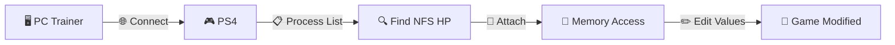

# PS4 Trainer - Need for Speed™ Hot Pursuit ReTuned v1

<div align="center">


**🔥 A sleek Windows Forms trainer for editing game values in Need for Speed: Hot Pursuit (PS4, v1.03) over the network using `libdebug`.**

</div>

---

## ⚠️ Disclaimer

> 🚨 **USE AT YOUR OWN RISK.** This tool is provided for **educational and personal use only**. Modifying game memory may violate the game's Terms of Service. The authors are **not responsible** for any bans, data loss, or damages incurred through use of this software.

---

## ✨ Features

| 🎯 Feature | 📝 Description |
|-----------|----------------|
| 🌐 **PS4 Network Connection** | Connect to a jailbroken PS4 via IP address & port |
| 🔗 **Process Attachment** | Automatically attach to the running NFS HP game process |
| 💾 **Memory Editing** | Modify numeric game values in real time via a clean UI |
| 🪟 **Draggable Window** | Custom draggable title bar for a borderless experience |
| 🎚️ **Decimal Precision** | Numeric inputs configured with 2 decimal places |
| ⚡ **Async Operations** | Non-blocking threading for smooth UI performance |

---

## 📋 Requirements

- 🪟 **Windows OS**
- 🧩 [**.NET Framework**](https://dotnet.microsoft.com/) — matching the target framework in the `.csproj`
- 🎨 [**Guna UI2**](https://gunaui.com/) — modern UI component library
- 🛠️ [**libdebug**](https://github.com/GoldHEN/libdebug) — PS4 debugging library
- 🎮 A **jailbroken PS4** running **GoldHEN** payload
- 🏎️ **NFS HP (v1.03)** installed and running on the console

---

## 📁 Project Structure

```
NFS_HP_1_03/
├── 📄 Form1.cs          # Main form logic
├── 🎨 Form1.Designer.cs # UI layout definitions
└── 📦 Form1.resx        # Form resources
```

---

## ⚙️ How It Works



1. 🌐 **Connect to PS4** — Establishes a `PS4DBG` connection using the configured IP and port
2. 📋 **Fetch Process List** — Retrieves running processes via `processList` and locates NFS HP by name
3. 🆔 **Store PID** — Saves the game's process ID in `PS4_PID`
4. 🔧 **Attach & Edit** — Reads/writes memory at predefined offsets to change in-game values
5. 🎚️ **Update UI** — Numeric inputs are initialized with two decimal places for precise editing

---

## 🚀 Usage

> **Step-by-step guide:**

1. 🛡️ Ensure your PS4 is **jailbroken** and **GoldHEN** is running
2. 🎮 Launch **Need for Speed: Hot Pursuit** and load into gameplay
3. ▶️ Start the trainer executable on your PC
4. 🌐 Enter your PS4's **IP address** and **port** in the connection fields
5. 🔌 Click **Connect** to establish a link to the console
6. 🔗 Click **Attach** to hook into the game process
7. ✏️ Use the numeric input fields to modify values — changes apply **immediately**

> 💡 **Pro Tip:** Drag the window using the custom title bar by clicking and moving the mouse 🖱️

---

## 🧠 Code Overview

### 🔑 Key Fields

| 🏷️ Field | 🔤 Type | 🎯 Purpose |
|----------|---------|-----------|
| `isDragging` | `bool` | Tracks whether the window is being dragged |
| `lastLocation` | `Point` | Stores cursor position during dragging |
| `PS4` | `PS4DBG` | libdebug connection object to the PS4 |
| `processList` | `ProcessList` | Snapshot of running processes on the PS4 |
| `PS4_PID` | `int` | PID of the attached NFS HP process |

### 🏗️ Constructor

```csharp
public Form1()
{
    InitializeComponent();
    numericUpDown1.DecimalPlaces = 2;
    numericUpDown2.DecimalPlaces = 2;
    numericUpDown3.DecimalPlaces = 2;
    // ...
}
```

Initializes the form and configures numeric input controls for decimal editing. 🎚️

### 📚 Dependencies

| 📦 Namespace | 🔧 Purpose |
|--------------|-----------|
| `System.Windows.Forms` | UI framework |
| `Guna.UI2` | Custom controls (draggable panel, buttons) |
| `libdebug` | PS4 debugging & connection |
| `System.Diagnostics` | Process utilities |
| `System.Text.RegularExpressions` | Value parsing (reserved) |
| `System.Threading` / `Tasks` | Async operations |

---

## 🔨 Building

```bash
# 1️⃣ Clone the repository
git clone <your-repo-url>
cd NFS_HP_1_03

# 2️⃣ Open in Visual Studio 2019+
# 3️⃣ Restore NuGet packages
#    - Guna.UI2.WinForms
#    - libdebug

# 4️⃣ Build in Release mode
# 5️⃣ Run NFS_HP_1_03.exe as Administrator
```

> ⚠️ **Run as Administrator** is required for certain network operations.

---

## 🐛 Troubleshooting

| ❓ Issue | 💡 Solution |
|---------|------------|
| ❌ Can't connect to PS4 | Verify IP/port and that GoldHEN is running |
| ❌ Process not found | Make sure NFS HP v1.03 is loaded into gameplay |
| ❌ Values not changing | Confirm you attached to the correct PID |
| ❌ App crashes on start | Ensure .NET Framework and NuGet deps are installed |

---

## 📜 License

This project is provided **as-is** for educational purposes. See the repository's `LICENSE` file if present. **No warranty is provided.** 📄

---

## 🙏 Acknowledgments

- 🏆 [**GoldHEN**](https://github.com/GoldHEN/GoldHEN) — PS4 payload
- 🛠️ [**libdebug**](https://github.com/GoldHEN/libdebug) — PS4 debugging library
- 🎨 [**Guna UI**](https://gunaui.com/) — Modern UI toolkit
- 🎮 **Need for Speed: Hot Pursuit** community

---

<div align="center">

**⭐ If you found this useful, give it a star! ⭐**

Made with ❤️ and ☕

</div>
